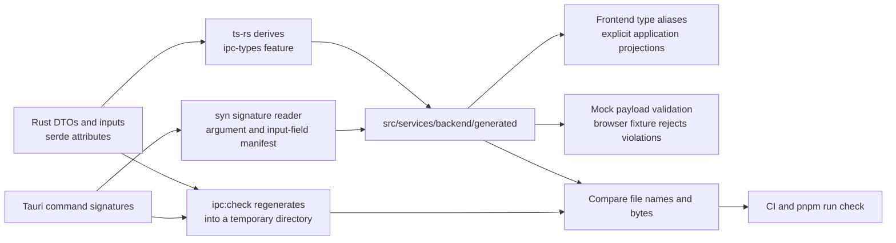

# IPC contracts

Rust DTOs and input structs are the source of the wire types in
`src/services/backend/generated/`. Do not edit those files. Run
`pnpm ipc:generate` after changing a command signature, DTO, input, or serde
attribute. `pnpm ipc:check` generates into a temporary directory and compares
both file names and contents with the checked-in tree. Missing, extra, and
changed files fail the check. CI and `pnpm run check` run it.

## Why ts-rs

`ts-rs` derives from the types compiled by both Rust crates, including their
field types, enum variants, and serde casing. It needs two additional packages,
`ts-rs` and `ts-rs-macros`; its optional formatting dependency is disabled.
The optional `ipc-types` feature enables the derives and export tests. Desktop
export tests also compile the mobile tray DTOs and plugin fallback module, so their
DTOs are checked and exported without a mobile toolchain. Normal builds do not
compile or link `ts-rs`, so release binaries carry no type metadata
or exporter. Export checks do compile a second feature configuration of the
application; this is a deliberate build-time cost. We chose ts-rs because its
derive and export tests cover the existing serde types without adding command
registration infrastructure. Its [serde support and export configuration](https://docs.rs/ts-rs/12.0.1/ts_rs/)
also cover the casing and JSON-number conventions used here.

The signature reader uses Rust's syntax tree, not a regular expression. It
removes Tauri-injected handles and state, applies command argument casing,
and reads nested input field names and serde defaults. It checks both desktop
and mobile command signatures for matching argument shapes. Public serde DTOs
in command modules and structs used directly as command arguments or returns
must have a TS derive and `ts(export)`; nested dependencies are checked by
the TS trait bounds.

Large Rust integers export as TypeScript `number`, matching Tauri's JSON
transport. This retains the existing JavaScript integer precision limit; it
does not introduce bigint or change the wire format. `Option<T>` DTO fields
are nullable. Input-only structs additionally accept omitted Option fields.
For structs that also serialize, generated types describe the serialization
shape. Non-Option fields with serde defaults also stay required in the
generated declarations. `DeserializeWireInput` combines these types with the
manifest's required-field flags to accept omitted defaults, including nested
attachments. Send and draft adapters use it with `satisfies`, preserving their
existing payloads. The mock uses the same flags at runtime.

## Explicit frontend projections

Most `Backend*` names are aliases of generated types. The following
application-facing differences remain explicit through `OptionalWireFields`,
`RefinedWireFields`, and `ProjectedWireFields`:

- Cached rows, older fixtures, and editor models keep existing optional
  fields. The frontend supplies defaults or constructs records before server
  IDs exist. Every widened key is listed in the alias. Thread pages keep that projection for their nested thread rows,
  and drafts keep it for outgoing attachments. These aliases are intentionally
  broader than a current Rust response; generated DTOs retain the exact shape.
- Account kinds, topic statuses and timeline kinds, signature assignment modes,
  sender categories, smart buckets, and original-source statuses use frontend
  unions. Rust stores these as strings. These refinements must be assignable to
  the generated field types. Their producers use fixed values, database CHECK
  constraints, or validation; the alias documents that domain assumption instead of pretending Rust declared an enum. Import progress,
  discovery, OAuth, and other unrefined string fields now use generated strings.
- Discovery configuration and rule trigger configuration are JSON object views
  used by their editors. Rust's `serde_json::Value` can represent any JSON.
  These views describe the objects the application writes and constructs,
  while the generated DTOs retain `JsonValue`.
- Draft `send_options` is persisted JSON, populated from the corresponding
  subset of `OutgoingMessageInput`. Its frontend projection picks generated
  fields and keeps the editor's priority union. Draft signature variants keep
  the editor's known-value union. Arbitrary JSON blobs have no generated inner
  schema.
- The error decoder accepts frontend Error causes with arbitrary interpolation
  values as well as Rust JSON errors. Its `CommandError` projection widens
  only `params`; the key and field names remain generated.
- `BackendSendMessagePayload` and `BackendDraftInput` are caller-facing
  camelCase models. Their adapters explicitly build the generated snake_case
  inputs. `BackendDraftSendOptions` describes the persisted JSON view, rather
  than a separate Rust input struct.

`SetSenderPreferenceInput.category` uses a custom deserializer. Its domain
field is an update enum, but the input is an optional nullable string: omission
keeps the category, null clears it, and a string sets it. The field's explicit
`ts(as = "Option<String>")` override describes that wire representation.
`ts-rs` reports the unsupported `deserialize_with` attribute during export;
the override is covered by the Rust deserialization tests. Filename serializers
also keep their `String` wire type; their control-character filtering is covered
by the existing Rust filename tests.

## What the mock checks

The mock validates payloads before looking up or invoking a handler. It rejects
unknown commands, extra or missing argument names, and mismatched nested field
names, including fields inside arrays. Top-level command arguments retain
camelCase; nested structs retain their existing serde conventions. Omitted
Option fields and serde defaults are accepted.

The smoke suite uses an automatic fixture that fails on any invalid mock
payload, even if a store catches the exception. The manifest checks names and
object/array structure, not scalar values, arbitrary JSON keys, enum values,
or custom deserializer logic. This complements generated TypeScript and Rust
serde tests; it does not claim to run Tauri's deserializer in the browser.
