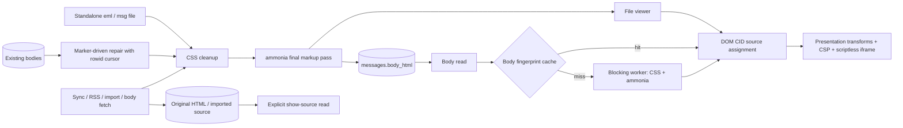

# Mail HTML processing

CSS cleanup happens before the final ammonia pass. No string rewrite may add
markup after that pass. The reader and file viewer resolve CID image sources
through DOM attributes, accepting only validated image MIME types and local
base64 data URLs. The renderer drops sender link/meta nodes before constructing
the iframe, whose first meta remains the application CSP. Its sandbox does not
allow scripts.

Ingest preserves original HTML separately from display HTML. Import also stores
the source passed to its parser: MSG file bytes or RFC 822 source from the
existing MBOX reader. Synced mail obtains its complete MIME source from the
provider on explicit request. The legacy repair keeps the old HTML
before replacing it, and commits each block with its cursor. The stored-body
sanitizer preserves the already-generated body presentation marker.

Body sanitizing and PGP/S/MIME verification run in the blocking pool. Each cache
holds at most 64 messages and 8 MiB, with a 60-second maximum age. Content
fingerprints replace stale per-message entries when bodies, signatures, sender
identity or verification keys change. S/MIME includes local certificate and
trust-origin data; the expiry bounds changes to the operating-system trust
store and certificate validity between calls.

## Signed mail

A signature state only appears over the bytes it was verified on. For
`multipart/signed`, `email::signed_mime` is the one splitter for display and
verification. A container it does not take, because the protocol is missing
or unknown or the structure is ambiguous, is shown unsigned. That container
never takes over a signature from a nested part either. A signature below the
root only ever gives a partial state.

Stored rows show their verdict by construction, not by comparison:

- Ingest marks a root that the strict splitter wrote together with its bundle
  (`MessageTrust::signed_binding`). Only such a row shows its stored body under
  the signature.
- Every other root-signed row shows the entity decoded from its stored bundle,
  the same bytes verification reads. This covers rows from before the marker,
  evicted bodies, and bodies rewritten later (body fetch, legacy repair, both
  of which drop the marker). If the bundle does not split, no verdict is shown.
- Opaque S/MIME (`application/pkcs7-mime`, signed-data) shows the content the
  engine read while verifying. Without that content there is no body and no
  verdict, never the stored body, the snippet or the subject. A body fetched
  later is read back through the same path before a verdict sits next to it.
  A stored bundle is detached only if it opens with its `Content-Type` line,
  as every writer puts it; opaque DER is never split for a header inside it.
- A signed entity that displays nothing (an encrypted part, say) leaves the
  signature without a body: no verdict, `signedContentUnavailable`.
- A body fetched on its own is written back only into the IMAP generation it
  was fetched from, in the same writer transaction that drops the marker.

Attachments next to a root signature:

- IMAP, POP3 and imported mail list them from the signed entity as the
  splitter cut it; part numbers resolve the same way when the bytes are
  fetched.
- The signature part's headers are not signed, so that part is never offered.
  Gmail keeps the MIME tree: only parts under the root's first child, the
  signed entity, are listed. Graph lists parts without their position: the
  part with the signature part's own type and file name is dropped. A file
  of a signature type inside the signed entity, the detached signature of a
  download, stays.
- `attachments.listing_rules` records the rules a row was written under. Rows
  from before (`0`) may name parts from outside the signed entity, including
  ones whose Content-ID fills the signed HTML. Beside a root signature they
  are not listed, so no `cid:` resolves from them, until the
  `signed_entity_attachments` repair has replaced them with the entity's own
  parts, their bytes taken from the bundle. The binding marker cannot stand
  in for this: a refetched body drops it and leaves the attachments as they
  were.
- Residual gap: Gmail and Outlook list the remaining attachments from their
  own MIME parse and serve the bytes by their own part id. Those bytes are not
  checked against the signed entity. A provider that splits a message
  differently from Satchel could offer a part the signature does not cover.
- A signature below the root (a forwarded signed part, a list footer added
  around one) only reaches the partial state. Its card says the text shown may
  not be the signed part: the display shows the message's first text, which
  need not be the one signed.
