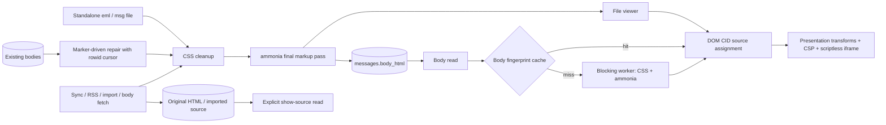

# Mail HTML processing

CSS cleanup happens before the final ammonia pass. No string rewrite may add
markup after that pass. The reader and file viewer resolve CID image sources
through DOM attributes, accepting only validated image MIME types and local
base64 data URLs. The renderer drops sender link/meta nodes before constructing
the iframe, whose first meta remains the application CSP. Its sandbox does not
allow scripts.

Ingest preserves original HTML separately from display HTML. Import also stores
the source passed to its parser: MSG file bytes or RFC 822 source from the
existing MBOX reader. Synced mail obtains its complete MIME source from the
provider on explicit request. The legacy repair keeps the old HTML
before replacing it, and commits each block with its cursor. The stored-body
sanitizer preserves the already-generated body presentation marker.

Body sanitizing and PGP/S/MIME verification run in the blocking pool. Each cache
holds at most 64 messages and 8 MiB, with a 60-second maximum age. Content
fingerprints replace stale per-message entries when bodies, signatures, sender
identity or verification keys change. S/MIME includes local certificate and
trust-origin data; the expiry bounds changes to the operating-system trust
store and certificate validity between calls.

Decrypted MIME unwrapping, charset decoding and sanitization run together in
Core on a blocking worker. Incomplete encrypted layers and malformed signed
structures return an error while the stored encrypted source remains intact.
Transient decryption captions require an exact snapshot of the segments,
final sanitized HTML and published attachment inputs. The store keeps that
snapshot with its body and discards it on raw replacement; the renderer checks
it before granting captions. Sender-controlled markers never grant provenance.
The prepared-body cache compares exact inline-image inputs, including byte
replacements of the same length.
