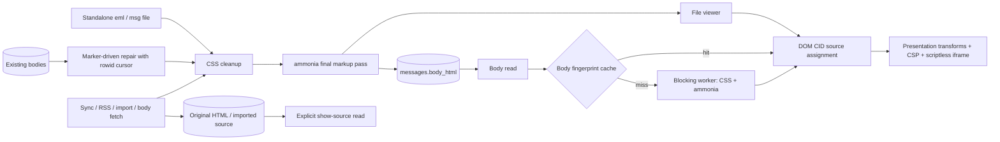

# Mail HTML processing

CSS cleanup happens before the final ammonia pass. No string rewrite may add
markup after that pass. The reader and file viewer resolve CID image sources
through DOM attributes, accepting only validated image MIME types and local
base64 data URLs. The renderer drops sender link/meta nodes before constructing
the iframe, whose first meta remains the application CSP. Its sandbox does not
allow scripts.

Ingest preserves original HTML separately from display HTML. Import also stores
the source passed to its parser: MSG file bytes or RFC 822 source from the
existing MBOX reader. Synced mail obtains its complete MIME source from the
provider on explicit request. The legacy repair keeps the old HTML
before replacing it, and commits each block with its cursor. The stored-body
sanitizer preserves the already-generated body presentation marker.

Body sanitizing and PGP/S/MIME verification run in the blocking pool. Each cache
holds at most 64 messages and 8 MiB, with a 60-second maximum age. Content
fingerprints replace stale per-message entries when bodies, signatures, sender
identity or verification keys change. S/MIME includes local certificate and
trust-origin data; the expiry bounds changes to the operating-system trust
store and certificate validity between calls.

Decrypted MIME unwrapping, charset decoding and sanitization run together in
Core on a blocking worker. A decrypted S/MIME payload, and an OpenPGP plaintext
that declares MIME, has no second copy, so `decode_complete_mime` accounts for
every part at any depth: it is shown, listed as an attachment, consumed as a
signature or as one of several alternatives, or the entity is refused with a
typed error. All text parts are shown in order, each as a segment of its own,
because Apple Mail writes an attachment placed mid-body as text, file, text.
Calendar and contact parts, and parts without a name, are listed as files. A
multipart without a boundary or parts, a malformed signed structure, an
encrypted layer shown in place, and opaque signed-data below the root are
refused; the stored encrypted source remains intact. A signature below the
root is recorded with partial scope over a part that is shown, never over one
that is not. The decoder takes a signed entity from `email::signed_mime`, the
splitter display and verification of synced mail use (see "Signed mail"), so
it refuses the same ambiguous shapes; there the refusal fails the decrypted
entity instead of showing it unsigned. A signature is checked against the
signed entity exactly as the decoder splits and shows it: the verifier gets a
bundle rebuilt from those bytes around a boundary that occurs in neither part,
and both verifiers split that bundle with the same splitter again. Apart from
signed structures, the shared parser for synced mail keeps its lenient
behaviour.

Transient decryption captions require an exact snapshot of the segments,
final sanitized HTML and published attachment inputs. Attachments match by
position, because a `cid:` reference shows the first attachment that carries
it; the listing breaks filename ties by ID so the order stays the same. Only
images the renderer may hydrate (inline ones, and those an ``
names by Content-ID or file name) carry their bytes in the snapshot; other
files are bound by ID, name, type, size, Content-ID, inline flag and cache
path. The store keeps
that snapshot with its body and discards it on raw replacement; the renderer
checks it before granting captions. Sender-controlled markers never grant
provenance. The prepared-body cache compares exact inline-image inputs,
including byte replacements of the same length.

Inline OpenPGP is decrypted wherever the stored text holds one armored block.
A cover note and a suffix stay plain text segments. The block's own HTML and a
whole-message signature scope apply only when the block is the entire root
body. A body with several blocks is not decrypted: it shows an error instead
of captioning one block as the decrypted message. A block among other text
that the unlocked keys cannot decrypt, such as one quoted from a message to
someone else, leaves the message state alone; its own segment says it was not
decrypted. A root signature over a body in which a block was decrypted signs
the ciphertext, not the plaintext shown, so it counts as a partial signature,
and it does not overwrite the decrypted content's own signature state unless
it is the worse claim. Content that failed to decrypt or decode is the worst
claim, so a valid outer signature never hides the error.

## Decrypted content at rest

Decrypted bodies are transient. Text, HTML and segments are computed on each
read and held only in memory: the short-lived processing caches above and the
frontend message store. The database keeps the encrypted source.

Decrypted attachments are not transient. To open, save and preview them like
any other attachment, `persist_decrypted_attachments` writes each part found
in decrypted content (S/MIME, PGP/MIME, and inline OpenPGP, including a block
after a cover note or one quoted in a reply) as plaintext into the attachment
cache under the app data directory (`satchel/attachments`). It records the
file name, MIME type, size and Content-ID in the `attachments` table. The
rolling body window releases these files like any other attachment cache, and
the maintenance worker deletes cache files that no row references. Satchel does
not encrypt them, which is the same protection the SQLite database has (see
`PRIVACY.md`): protect the device and its backups accordingly.

These rows have no remote part ID. The server holds the part only inside the
encrypted message, where the decoder's part number names a different part.
Once the cache file is gone, opening or saving the attachment fails with a
message to open the mail again, which decrypts it anew; it is never fetched
from the server under this row. Sync does not match these rows to the
message's server parts, so a later sync may drop them until the mail is opened
again.

Each decrypted file is named for the message's saved IMAP generation, like any
other attachment cache, and written in the same writer transaction that checks
that generation. Its row carries the current `listing_rules` and stays outside
the signed-entity rules below: a listing beside a root signature does not hide
it, and the `signed_entity_attachments` repair neither removes it nor counts it
as the signed entity's list.

The background invitation scan skips these rows. A decrypted invitation is
listed as `invite.ics` on its message, but it is not copied into
`calendar_invites`, whose rows keep the summary, organizer and raw ICS after
the message is deleted.

## Signed mail

A signature state only appears over the bytes it was verified on. For
`multipart/signed`, `email::signed_mime` is the one splitter for display and
verification. A container it does not take, because the protocol is missing
or unknown or the structure is ambiguous, is shown unsigned. That container
never takes over a signature from a nested part either. A signature below the
root only ever gives a partial state.

Stored rows show their verdict by construction, not by comparison:

- Ingest marks a root that the strict splitter wrote together with its bundle
  (`MessageTrust::signed_binding`). Only such a row shows its stored body under
  the signature.
- Every other root-signed row shows the entity decoded from its stored bundle,
  the same bytes verification reads. This covers rows from before the marker,
  evicted bodies, and bodies rewritten later (body fetch, legacy repair, both
  of which drop the marker). If the bundle does not split, no verdict is shown.
- Opaque S/MIME (`application/pkcs7-mime`, signed-data) shows the content the
  engine read while verifying. Without that content there is no body and no
  verdict, never the stored body, the snippet or the subject. A body fetched
  later is read back through the same path before a verdict sits next to it.
  A stored bundle is detached only if it opens with its `Content-Type` line,
  as every writer puts it; opaque DER is never split for a header inside it.
- A signed entity that displays nothing (an encrypted part, say) leaves the
  signature without a body: no verdict, `signedContentUnavailable`.
- A body fetched on its own is written back only into the IMAP generation it
  was fetched from, in the same writer transaction that drops the marker.
- The covered body is on the message before anything decodes it. An armored
  block inside a signed entity is decrypted from that entity, never from a
  stored body the signature was not checked over, and its plaintext leaves the
  root signature partial (see "Mail HTML processing").

Attachments next to a root signature:

- IMAP, POP3 and imported mail list them from the signed entity as the
  splitter cut it; part numbers resolve the same way when the bytes are
  fetched.
- The signature part's headers are not signed, so that part is never offered.
- Gmail and Outlook list parts from their own parse and serve them by their
  own id. Under a root signature that list is a whitelist against the signed
  entity the strict splitter cut from the stored bundle: each listed part has
  to match an entity part no other listed part took, on media type and file
  name, on Content-ID where both name one, on size where the provider counts
  decoded bytes (Gmail; Graph sizes its own item), and on bytes where the
  provider sent them inline. A matched row takes the entity part's type,
  name, Content-ID, inline flag, size and bytes; the provider id stays only
  as the row's key, and a download serves the entity's bytes. A signature
  part under any name (Graph's own, "Untitled"), and a part the entity does
  not hold, are not listed. If the bundle does not split, nothing is.
- Gmail keeps the MIME tree, so it is also held to RFC 1847's shape: the root
  `multipart/signed` has exactly two parts, the second of the declared
  signature type. Only parts under the first are candidates. A tree of any
  other shape lists no attachments.
- A file of a signature type inside the signed entity, the detached
  signature of a download, is an entity part and stays listed for Gmail and
  Outlook. IMAP, POP3 and import do not list signature-typed parts at all,
  inside the entity or not.
- `attachments.listing_rules` records the rules a row was written under. Rows
  from before (`0`) may name parts from outside the signed entity, including
  ones whose Content-ID fills the signed HTML. Beside a root signature they
  are not listed, so no `cid:` resolves from them, until the
  `signed_entity_attachments` repair has replaced them with the entity's own
  parts, their bytes taken from the bundle, and set the message's and its
  thread's attachment flag from the rows it leaves. A repair block stops after
  16 MiB of bundles (at least one). The binding marker cannot stand in for
  this: a refetched body drops it and leaves the attachments as they were.
- What stays unbound: which provider id a row keeps. Two entity parts the
  provider describes alike (same type, name and, for Graph, no size check)
  may swap ids; each row still serves its own entity part's bytes. An entity
  part the provider names differently from its headers, or lists not at all,
  is not offered: the listing fails closed rather than fall back to the
  provider's description.
- A signature below the root (a forwarded signed part, a list footer added
  around one) only reaches the partial state. Its card says the text shown may
  not be the signed part: the display shows the message's first text, which
  need not be the one signed.
