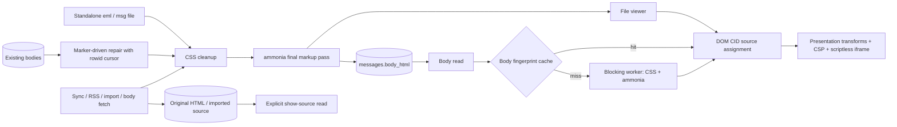

# Mail HTML processing

CSS cleanup happens before the final ammonia pass. No string rewrite may add
markup after that pass. The reader and file viewer resolve CID image sources
through DOM attributes, accepting only validated image MIME types and local
base64 data URLs. The renderer drops sender link/meta nodes before constructing
the iframe, whose first meta remains the application CSP. Its sandbox does not
allow scripts.

Ingest preserves original HTML separately from display HTML. Import also stores
the source passed to its parser: MSG file bytes or RFC 822 source from the
existing MBOX reader. Synced mail obtains its complete MIME source from the
provider on explicit request. The legacy repair keeps the old HTML
before replacing it, and commits each block with its cursor. The stored-body
sanitizer preserves the already-generated body presentation marker.

Body sanitizing and PGP/S/MIME verification run in the blocking pool. Each cache
holds at most 64 messages and 8 MiB, with a 60-second maximum age. Content
fingerprints replace stale per-message entries when bodies, signatures, sender
identity or verification keys change. S/MIME includes local certificate and
trust-origin data; the expiry bounds changes to the operating-system trust
store and certificate validity between calls.

Decrypted MIME unwrapping, charset decoding and sanitization run together in
Core on a blocking worker. A decrypted S/MIME payload, and an OpenPGP plaintext
that declares MIME, has no second copy, so `decode_complete_mime` accounts for
every part at any depth: it is shown, listed as an attachment, consumed as a
signature or as one of several alternatives, or the entity is refused with a
typed error. All text parts are shown in order, each as a segment of its own,
because Apple Mail writes an attachment placed mid-body as text, file, text.
Calendar and contact parts, and parts without a name, are listed as files. A
multipart without a boundary or parts, a malformed signed structure, an
encrypted layer shown in place, and opaque signed-data below the root are
refused; the stored encrypted source remains intact. A signature below the
root is recorded with partial scope over a part that is shown, never over one
that is not. A signature is checked against the signed entity exactly as the
decoder splits and shows it: the verifier gets a bundle rebuilt from those
bytes around a boundary that occurs in neither part, so its own MIME parser
cannot find another entity. The signature part must name the declared protocol
in its own `Content-Type`. The shared parser for synced mail keeps its lenient
behaviour.

Transient decryption captions require an exact snapshot of the segments,
final sanitized HTML and published attachment inputs. Attachments match by
position, because a `cid:` reference shows the first attachment that carries
it; the listing breaks filename ties by ID so the order stays the same. Only
images the renderer may hydrate (inline ones, and those an ``
names by Content-ID or file name) carry their bytes in the snapshot; other
files are bound by ID, name, type, size, Content-ID, inline flag and cache
path. The store keeps
that snapshot with its body and discards it on raw replacement; the renderer
checks it before granting captions. Sender-controlled markers never grant
provenance. The prepared-body cache compares exact inline-image inputs,
including byte replacements of the same length.

Inline OpenPGP is decrypted wherever the stored text holds one armored block.
A cover note and a suffix stay plain text segments. The block's own HTML and a
whole-message signature scope apply only when the block is the entire root
body. A body with several blocks is not decrypted: it shows an error instead
of captioning one block as the decrypted message. A block among other text
that the unlocked keys cannot decrypt, such as one quoted from a message to
someone else, leaves the message state alone; its own segment says it was not
decrypted. A root signature over a body in which a block was decrypted signs
the ciphertext, not the plaintext shown, so it counts as a partial signature,
and it does not overwrite the decrypted content's own signature state unless
it is the worse claim. Content that failed to decrypt or decode is the worst
claim, so a valid outer signature never hides the error.

## Decrypted content at rest

Decrypted bodies are transient. Text, HTML and segments are computed on each
read and held only in memory: the short-lived processing caches above and the
frontend message store. The database keeps the encrypted source.

Decrypted attachments are not transient. To open, save and preview them like
any other attachment, `persist_decrypted_attachments` writes each part found
in decrypted content (S/MIME, PGP/MIME, and inline OpenPGP, including a block
after a cover note or one quoted in a reply) as plaintext into the attachment
cache under the app data directory (`satchel/attachments`). It records the
file name, MIME type, size and Content-ID in the `attachments` table. The
rolling body window releases these files like any other attachment cache, and
the maintenance worker deletes cache files that no row references. Satchel does
not encrypt them, which is the same protection the SQLite database has (see
`PRIVACY.md`): protect the device and its backups accordingly.

These rows have no remote part ID. The server holds the part only inside the
encrypted message, where the decoder's part number names a different part.
Once the cache file is gone, opening or saving the attachment fails with a
message to open the mail again, which decrypts it anew; it is never fetched
from the server under this row. Sync does not match these rows to the
message's server parts, so a later sync may drop them until the mail is opened
again.

The background invitation scan skips these rows. A decrypted invitation is
listed as `invite.ics` on its message, but it is not copied into
`calendar_invites`, whose rows keep the summary, organizer and raw ICS after
the message is deleted.
