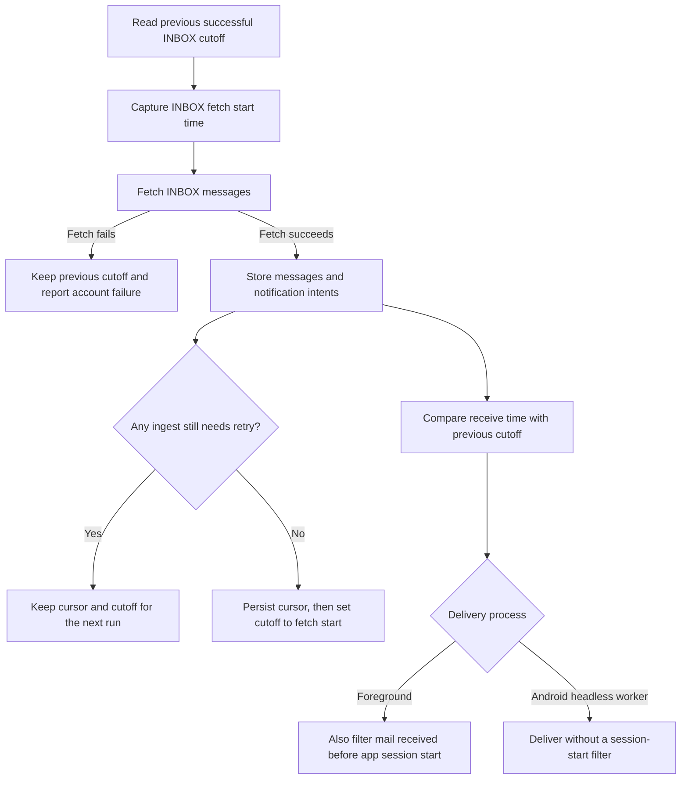

# Mail notification cutoffs

`accounts.last_sync_at` records the start of the last successfully stored
INBOX fetch. Archive, Sent and history fetches do not move it. A failed INBOX
fetch or an ingest waiting for another quarantine attempt leaves it unchanged.
The next run therefore keeps the interval that still needs downloading.

The notification trigger compares each arrival against the previous cutoff.
IMAP uses INTERNALDATE, Gmail uses internalDate, and Graph uses
receivedDateTime. Providers without a receive timestamp fall back to the
message date. The sender's Date remains the date shown in the mailbox. Fetch and session
cutoffs use whole seconds to match INTERNALDATE's precision. The overlap within
one second cannot create another intent for a message already stored.

A new account with no previous cutoff keeps the existing fifteen-minute
bootstrap window. Foreground startup also suppresses arrivals from before the
current app session. Android WorkManager has no foreground session; it claims
the durable intents that passed the persisted INBOX cutoff.

Quarantine holds the folder's previous cursor whenever an ingest fails, even
if every other message in the batch succeeds. A later run retries the batch.
After three failed ingest attempts, the message is skipped and remains in
`sync_quarantine` for diagnosis. Successfully stored messages are idempotent.
POP3 deletion intents include only successfully stored messages without a
previous quarantine failure, even while the cursor is held for another mail.

An IMAP UIDVALIDITY reset clears the old generation's cursor and quarantine
before storing new messages. Retrying an ingest then keeps the new generation
instead of resetting and removing the same messages on every attempt.
